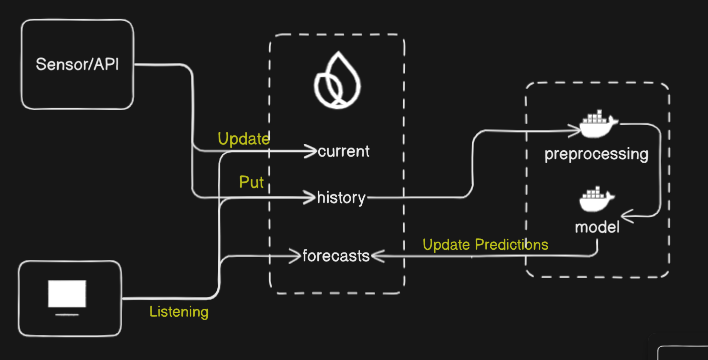
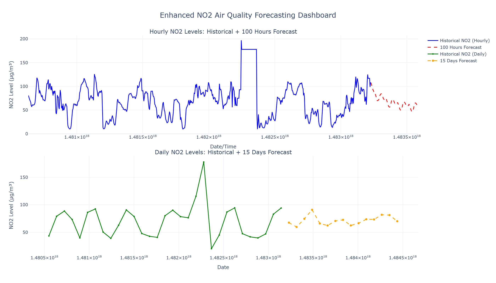
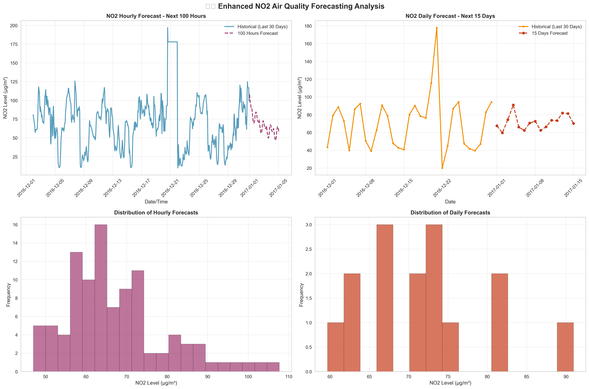
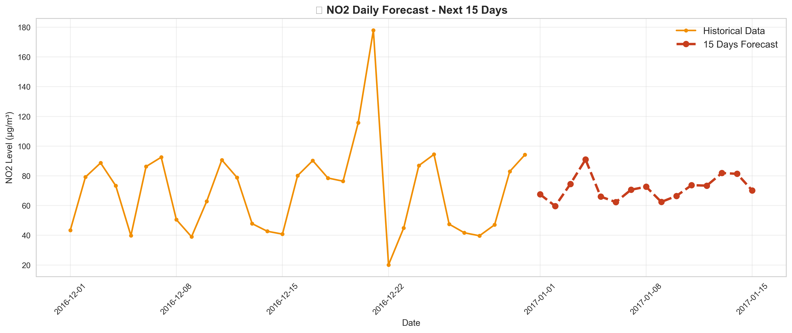
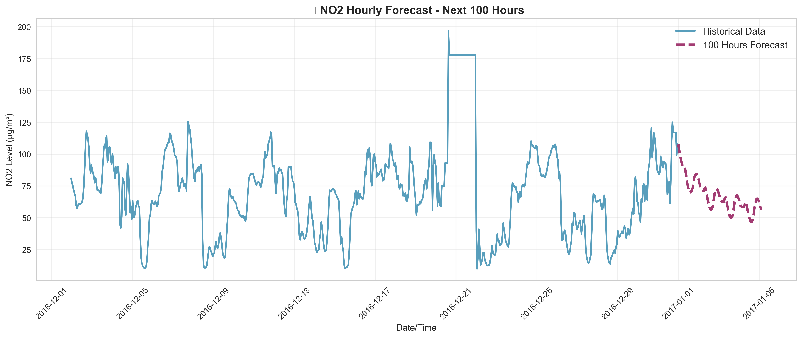
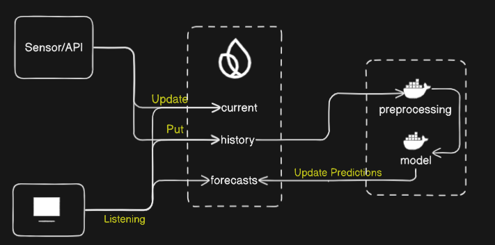

# ProSmart-AQI: Intelligent Air Quality Monitoring & Prediction System



## 🌟 Overview

ProSmart-AQI is an advanced air quality monitoring and prediction system that combines real-time sensor data collection with machine learning-powered forecasting. The system provides comprehensive air quality insights through an intelligent dashboard and automated prediction pipeline.

## 🏗️ System Architecture

The system follows a modular architecture with three main components:

1. **Sensor/API Layer**: Real-time data collection from air quality sensors
2. **Firebase Database**: Cloud storage for current readings, historical data, and forecasts
3. **ML Processing Pipeline**: Advanced machine learning models for air quality prediction
4. **Frontend Dashboard**: Interactive web interface for data visualization and monitoring

## 📊 Monitored Parameters

The system tracks multiple air quality parameters:

- **Temperature** (°C) - Environmental temperature readings
- **PM2.5** (μg/m³) - Fine particulate matter
- **PM10** (μg/m³) - Coarse particulate matter
- **CO** (ppm) - Carbon monoxide levels
- **NO2** (ppb) - Nitrogen dioxide concentration
- **O3** (ppb) - Ozone levels
- **SO2** (ppb) - Sulfur dioxide concentration
- **VOCs** - Volatile organic compounds
- **Humidity** (%) - Relative humidity
- **AQI** - Calculated Air Quality Index

## 🤖 Machine Learning Models

### LSTM-CNN Hybrid Model
- **Architecture**: Bidirectional LSTM with CNN layers
- **Purpose**: Multi-parameter air quality forecasting
- **Features**: 
  - Sequence-to-sequence prediction
  - Dropout regularization (0.2)
  - Bidirectional processing for enhanced temporal understanding

### ARIMA Models
- **Purpose**: Time series forecasting for individual parameters
- **Implementation**: Statistical modeling for trend analysis
- **Integration**: Combined with LSTM for ensemble predictions

### PyCaret Integration
- **AutoML**: Automated model selection and optimization
- **Preprocessing**: Feature engineering and data preparation
- **Deployment**: Model serving and prediction pipeline

## 🚀 Prediction Capabilities

The system provides forecasts for multiple time horizons:
- **6 hours** - Short-term predictions
- **48 hours** - Medium-term forecasting
- **15 days** - Long-term trend analysis
- **Weekly** - Extended period predictions

Each prediction includes:
- Multi-parameter forecasts
- Confidence scores (0-100%)
- Trend analysis
- Alert thresholds

## 💻 Technology Stack

### Backend
- **Python 3.x** - Core processing language
- **PyTorch** - Deep learning framework
- **PyCaret** - AutoML library
- **Prophet** - Time series forecasting
- **Flask** - API framework
- **Firebase Admin** - Database integration
- **Schedule** - Task automation

### Frontend
- **React 19** - Modern UI framework
- **Vite** - Fast build tool
- **TailwindCSS** - Utility-first styling
- **Recharts** - Data visualization
- **Framer Motion** - Smooth animations
- **Lucide React** - Icon library

### Infrastructure
- **Docker** - Containerization
- **Firebase** - Real-time database
- **GitHub** - Version control

## 🏃‍♂️ Quick Start

### Prerequisites
- Python 3.8+
- Node.js 16+
- Docker (optional)
- Firebase account

### Backend Setup
```bash
cd Deployment/ProsMartAQI
pip install -r requirements.txt
python main.py
```

### Frontend Setup
```bash
cd frontend
npm install
npm run dev
```

### Docker Deployment
```bash
cd Deployment/ProsMartAQI
docker build -t prosmart-aqi .
docker run -d prosmart-aqi
```

## 📈 Features

### Real-time Monitoring
- Live sensor data visualization
- Interactive charts and graphs
- Status indicators and alerts
- Historical data analysis

### Predictive Analytics
- Multi-parameter forecasting
- Trend analysis and patterns
- Confidence scoring
- Automated model updates

### User Interface
- Responsive dashboard design
- Real-time data updates
- Customizable time ranges
- Export capabilities

### Automation
- Scheduled data collection (every 30 minutes)
- Automated model retraining
- Alert notifications
- Report generation

## 📁 Project Structure

```
ProSmart-AQI/
├── Dataset/                    # Training data
├── Deployment/                 # Production deployment
│   ├── ProsMartAQI/           # Main application
│   ├── forecast_images/       # Generated visualizations
│   └── forecast_reports/      # Prediction reports
├── frontend/                  # React dashboard
│   ├── src/components/        # UI components
│   └── src/entities/          # Data models
├── MODEL/                     # Machine learning models
│   ├── LSTM-CNN/             # Deep learning models
│   ├── LSTM-ARIMA/           # Hybrid models
│   └── Arima/                # Statistical models
├── Images/                    # Documentation assets
└── visualizations/           # Generated plots
```

## 📊 Data Pipeline

1. **Collection**: Sensors → API → Firebase
2. **Processing**: Data validation and cleaning
3. **Storage**: Historical data archival
4. **Prediction**: ML model inference
5. **Visualization**: Dashboard updates
6. **Alerts**: Threshold monitoring

## 🔧 Configuration

### Environment Variables
- `FIREBASE_CONFIG`: Firebase configuration
- `MODEL_PATH`: Path to trained models
- `UPDATE_INTERVAL`: Data collection frequency
- `ALERT_THRESHOLDS`: Warning levels

### Model Parameters
- `CFG.target_size`: Output dimensions
- `CFG.input_size`: Feature count
- `CFG.hidden_size`: LSTM hidden units
- `CFG.num_layers`: Network depth
- `CFG.seq_length`: Input sequence length

## 📱 API Endpoints

- `GET /current` - Latest sensor readings
- `GET /history` - Historical data
- `GET /predictions` - Forecast data
- `POST /update` - Manual data update

## 🚨 Alerts & Monitoring

The system provides automated alerts for:
- AQI threshold violations
- Sensor malfunction detection
- Prediction confidence drops
- Data quality issues

## 🤝 Contributing

1. Fork the repository
2. Create a feature branch
3. Make your changes
4. Add tests if applicable
5. Submit a pull request

## 📄 License

This project is licensed under the MIT License - see the LICENSE file for details.

## 🙏 Acknowledgments

- Firebase for real-time database services
- PyCaret community for AutoML tools
- React team for the frontend framework
- PyTorch team for deep learning capabilities

## 📞 Support

For support and questions:
- Create an issue on GitHub
- Check the documentation
- Review existing discussions

---

## 📸 Additional Visualizations

### Enhanced NO2 Dashboard


### NO2 Forecasting Results


### Daily Analysis


### Hourly Patterns


### Additional Visualization


---

*Built with ❤️ for cleaner air and healthier communities*
